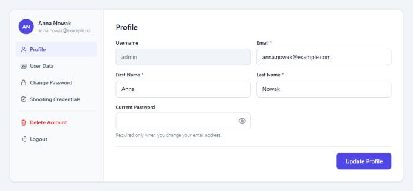
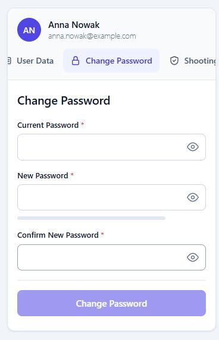

<div align="center">

# WP Secure User Management

**Registration, login, password reset and account pages for WordPress, with bot protection built in.**

Replaces `wp-login.php` with pages that match your site, and protects public forms with Cloudflare Turnstile.


**English** · [Polski](README.pl.md)

</div>

<table>
<tr>
<td width="70%"></td>
<td width="30%"></td>
</tr>
</table>

## Contents

- [Features](#features)
- [Requirements](#requirements)
- [Installation](#installation)
- [Shortcodes](#shortcodes)
- [Bot protection](#bot-protection)
- [Emergency switches](#emergency-switches)
- [Development](#development)
- [Documentation](#documentation)
- [License](#license)

## Features

### For your visitors

- **Registration with email confirmation.** No account exists until the link is opened. Unconfirmed sign-ups are deleted automatically.
- **Login** with a username or an email address, and a return to the page the visitor came from.
- **Password reset** on your own page, with an HTML email in the account's language.
- **Account page** with a side menu on desktop and a scrolling tab strip on phones: profile, user data, password, shooting credentials, account deletion.
- **Show/hide button** on every password field.

### For administrators

- **User list** with a search across all shown fields, selectable columns, role management and bulk deletion.
- **Configuration** of columns, profile fields, password length, page slugs and rate limits.
- **Polish and English** out of the box. Drop in a `.mo` file to add a language.

### Security

| Protection | What it does |
|---|---|
| **`wp-login.php` replacement** | Login, registration and reset run through the plugin's pages. A POST to `wp-login.php` is never processed. |
| **Cloudflare Turnstile** | Checks the token on the server for the plugin's forms, native WordPress forms, comments and WPForms. |
| **Rate limiting** | Separate limits for logins, resets, registrations and password checks, with Cloudflare-aware IP detection. |
| **`xmlrpc.php` blocking** | Refused by WordPress and, on Apache and LiteSpeed, by a `.htaccess` block that is verified after writing. |
| **No user enumeration** | Login and reset messages never reveal whether an account exists. |
| **Private documents** | Credential PDFs have random names and are served only to their owner and to administrators. |
| **Privacy tools** | Personal data exporter and eraser, plus suggested text for your privacy policy. |

### Works with your theme

Every style is scoped to `.wpum-ui` and overrides usual theme styling, so the forms look the same on any theme. Colours are CSS custom properties:

```css
.wpum-ui { --wpum-accent: #0f766e !important; }
```

## Requirements

| | |
|---|---|
| **WordPress** | 5.9 or newer |
| **PHP** | 7.4 or newer |
| **Outgoing email** | Required for registration and password reset. Use an SMTP plugin if your host's `mail()` is unreliable. |

## Installation

1. Copy the `wp-user-management-plugin` folder to `/wp-content/plugins/` and activate the plugin.
2. Create pages with the [shortcodes](#shortcodes) below. If their slugs differ from the defaults, set them in **User Management → Configuration**.
3. Optional: add your keys in **User Management → Turnstile**.

> [!IMPORTANT]
> `wp-login.php` is replaced by default, but only once a working page exists for each form. You cannot lock yourself out by forgetting a page: WordPress keeps its own form until then.

> [!WARNING]
> `xmlrpc.php` is blocked by default. This stops apps that need XML-RPC, such as the WordPress mobile app. See [Emergency switches](#emergency-switches) to allow it.

## Shortcodes

| Shortcode | Purpose | Default page slug |
|---|---|---|
| `[wpum_my_account_content]` | Profile when logged in, login form otherwise | `user-account` |
| `[wpum_user_registration]` | Registration form | `user-register` |
| `[wpum_password_reset]` | Password reset | `password-reset` |
| `[wpum_user_login]` | Login form only | |
| `[wpum_user_profile_edit]` | Profile only | |

## Bot protection

1. Create a Turnstile widget in the [Cloudflare dashboard](https://dash.cloudflare.com/?to=/:account/turnstile).
2. In **User Management → Turnstile**, paste the keys and press **Test keys**.
3. Choose the protected forms and save.

| Forms | Default |
|---|---|
| Plugin login, registration, password reset | On |
| Native `wp-login.php` forms | Off |
| Comments | Off |
| WPForms | Off |

For comments and WPForms you can skip the check for logged-in users, which is the default. Each form system needs its own check on the server, so only the systems listed in the settings can be protected.

Keys can also live in `wp-config.php`, where they override the settings page:

```php
define( 'WPUM_TURNSTILE_SITE_KEY', '0x4AAAA...' );
define( 'WPUM_TURNSTILE_SECRET_KEY', '0x4AAAA...' );
```

> [!NOTE]
> Another plugin that checks logins through the `authenticate` hook can refuse the plugin's login form, because the form does not carry that plugin's field. Simple Cloudflare Turnstile is handled. Others are not, so test logging in after adding one.

## Emergency switches

Add these to `wp-config.php` when you need a way back in without touching the database.

| Constant | Effect |
|---|---|
| `WPUM_KEEP_WP_LOGIN` | Keeps the native `wp-login.php` |
| `WPUM_TURNSTILE_DISABLE` | Switches Turnstile off |
| `WPUM_ALLOW_XMLRPC` | Allows XML-RPC and removes the `.htaccess` block |
| `WPUM_NO_HTACCESS` | Keeps the plugin away from `.htaccess` |

```php
define( 'WPUM_TURNSTILE_DISABLE', true );
```

## Development

The repository includes a [wp-env](https://www.npmjs.com/package/@wordpress/env) test site. It needs Docker and Node.

```bash
npx @wordpress/env start
```

| Site | Address | PHP |
|---|---|---|
| Main | <http://localhost:8890> (`admin` / `password`) | 8.3 |
| Tests | <http://localhost:8891> | 7.4, the oldest supported version |

The plugin is mounted live from `wp-user-management-plugin/`, and the debug log is on.

## Documentation

- **[Technical documentation](wp-user-management-plugin/README.md):** every feature in detail, with all limits and filters.
- **[Changelog](wp-user-management-plugin/CHANGELOG.md):** what changed in each version.

## License

[GPL v2 or later](https://www.gnu.org/licenses/gpl-2.0.html). Created by Jarosław Kłębucki.
