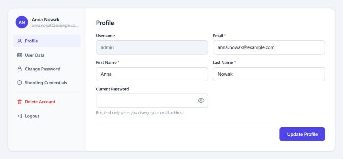
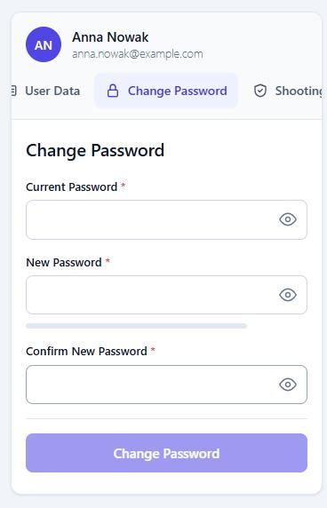

<div align="center">

# WP Secure User Management

**Rejestracja, logowanie, reset hasła i konto użytkownika w WordPressie, z wbudowaną ochroną przed botami.**

Zastępuje `wp-login.php` stronami dopasowanymi do Twojej witryny, a publiczne formularze chroni przez Cloudflare Turnstile.


[English](README.md) · **Polski**

</div>

<table>
<tr>
<td width="70%"></td>
<td width="30%"></td>
</tr>
</table>

<sub>Zrzuty pokazują wersję angielską. Wtyczka ma pełne tłumaczenie polskie.</sub>

## Spis treści

- [Funkcje](#funkcje)
- [Wymagania](#wymagania)
- [Instalacja](#instalacja)
- [Shortcody](#shortcody)
- [Ochrona przed botami](#ochrona-przed-botami)
- [Przełączniki awaryjne](#przełączniki-awaryjne)
- [Rozwój](#rozwój)
- [Dokumentacja](#dokumentacja)
- [Licencja](#licencja)

## Funkcje

### Dla odwiedzających

- **Rejestracja z potwierdzeniem emailem.** Konto powstaje dopiero po kliknięciu w link, a niepotwierdzone zgłoszenia są usuwane automatycznie.
- **Logowanie** nazwą użytkownika lub adresem email, z powrotem na stronę, z której przyszedł użytkownik.
- **Reset hasła** na Twojej stronie, z wiadomością HTML w języku konta.
- **Strona konta** z bocznym menu na komputerze i przewijanym paskiem zakładek na telefonie: profil, dane użytkownika, hasło, uprawnienia strzeleckie, usuwanie konta.
- **Przycisk pokazywania hasła** w każdym polu hasła.

### Dla administratorów

- **Lista użytkowników** z wyszukiwaniem po wszystkich widocznych polach, wyborem kolumn, zarządzaniem rolami i zbiorczym usuwaniem.
- **Konfiguracja** kolumn, pól profilu, długości hasła, adresów stron i limitów prób.
- **Polski i angielski** od razu po instalacji. Kolejny język to jeden plik `.mo`.

### Bezpieczeństwo

| Ochrona | Co robi |
|---|---|
| **Zastąpienie `wp-login.php`** | Logowanie, rejestracja i reset działają na stronach wtyczki. Żądanie POST do `wp-login.php` nigdy nie jest przetwarzane. |
| **Cloudflare Turnstile** | Sprawdza token na serwerze w formularzach wtyczki, natywnych formularzach WordPressa, komentarzach i WPForms. |
| **Limity prób** | Osobne limity dla logowania, resetu, rejestracji i sprawdzania hasła, z rozpoznawaniem adresu IP za Cloudflare. |
| **Blokada `xmlrpc.php`** | Odmowa po stronie WordPressa, a na Apache i LiteSpeed także przez wpis w `.htaccess` sprawdzany po zapisaniu. |
| **Bez ujawniania kont** | Komunikaty logowania i resetu nie zdradzają, czy konto istnieje. |
| **Prywatne dokumenty** | Pliki PDF z uprawnieniami mają losowe nazwy i są dostępne tylko dla właściciela i administratorów. |
| **Narzędzia prywatności** | Eksport i usuwanie danych osobowych oraz propozycja treści do polityki prywatności. |

### Działa z Twoim motywem

Wszystkie style są ograniczone do `.wpum-ui` i nadpisują zwykłe style motywu, więc formularze wyglądają tak samo w każdym motywie. Kolory ustawisz przez zmienne CSS:

```css
.wpum-ui { --wpum-accent: #0f766e !important; }
```

## Wymagania

| | |
|---|---|
| **WordPress** | 5.9 lub nowszy |
| **PHP** | 7.4 lub nowszy |
| **Wysyłka email** | Potrzebna do rejestracji i resetu hasła. Jeśli `mail()` na serwerze zawodzi, użyj wtyczki SMTP. |

## Instalacja

1. Skopiuj folder `wp-user-management-plugin` do `/wp-content/plugins/` i włącz wtyczkę.
2. Utwórz strony z poniższymi [shortcodami](#shortcody). Jeśli ich adresy różnią się od domyślnych, ustaw je w **Zarządzanie użytkownikami → Konfiguracja**.
3. Opcjonalnie: dodaj klucze w **Zarządzanie użytkownikami → Turnstile**.

> [!IMPORTANT]
> `wp-login.php` jest domyślnie zastępowany, ale dopiero gdy dla danego formularza istnieje działająca strona. Nie zablokujesz się więc, zapominając o stronie: do tego czasu WordPress zachowuje własny formularz.

> [!WARNING]
> `xmlrpc.php` jest domyślnie zablokowany. Przestają przez to działać aplikacje korzystające z XML-RPC, na przykład aplikacja mobilna WordPressa. Jak to odblokować, opisują [przełączniki awaryjne](#przełączniki-awaryjne).

## Shortcody

| Shortcode | Przeznaczenie | Domyślny adres strony |
|---|---|---|
| `[wpum_my_account_content]` | Profil po zalogowaniu, w przeciwnym razie formularz logowania | `user-account` |
| `[wpum_user_registration]` | Formularz rejestracji | `user-register` |
| `[wpum_password_reset]` | Reset hasła | `password-reset` |
| `[wpum_user_login]` | Tylko formularz logowania | |
| `[wpum_user_profile_edit]` | Tylko profil | |

## Ochrona przed botami

1. Utwórz widget Turnstile w [panelu Cloudflare](https://dash.cloudflare.com/?to=/:account/turnstile).
2. W **Zarządzanie użytkownikami → Turnstile** wklej klucze i kliknij **Testuj klucze**.
3. Wybierz chronione formularze i zapisz.

| Formularze | Domyślnie |
|---|---|
| Logowanie, rejestracja i reset hasła wtyczki | Włączone |
| Natywne formularze `wp-login.php` | Wyłączone |
| Komentarze | Wyłączone |
| WPForms | Wyłączone |

W komentarzach i WPForms sprawdzanie może być pomijane dla zalogowanych użytkowników i tak jest domyślnie. Każdy system formularzy wymaga własnego sprawdzania na serwerze, dlatego chronić można tylko te wymienione w ustawieniach.

Klucze można też umieścić w `wp-config.php`, gdzie mają pierwszeństwo przed stroną ustawień:

```php
define( 'WPUM_TURNSTILE_SITE_KEY', '0x4AAAA...' );
define( 'WPUM_TURNSTILE_SECRET_KEY', '0x4AAAA...' );
```

> [!NOTE]
> Inna wtyczka sprawdzająca logowanie przez hook `authenticate` może odrzucić logowanie w formularzu wtyczki, bo formularz nie ma jej pola. Simple Cloudflare Turnstile jest obsłużona, inne nie, więc po dodaniu takiej wtyczki sprawdź logowanie.

## Przełączniki awaryjne

Dodaj je do `wp-config.php`, gdy potrzebujesz wrócić do strony bez zmian w bazie danych.

| Stała | Działanie |
|---|---|
| `WPUM_KEEP_WP_LOGIN` | Zachowuje natywny `wp-login.php` |
| `WPUM_TURNSTILE_DISABLE` | Wyłącza Turnstile |
| `WPUM_ALLOW_XMLRPC` | Pozwala na XML-RPC i usuwa wpis z `.htaccess` |
| `WPUM_NO_HTACCESS` | Wtyczka nie dotyka pliku `.htaccess` |

```php
define( 'WPUM_TURNSTILE_DISABLE', true );
```

## Rozwój

Repozytorium zawiera stronę testową [wp-env](https://www.npmjs.com/package/@wordpress/env). Wymaga Dockera i Node.

```bash
npx @wordpress/env start
```

| Strona | Adres | PHP |
|---|---|---|
| Główna | <http://localhost:8890> (`admin` / `password`) | 8.3 |
| Testowa | <http://localhost:8891> | 7.4, najstarsza obsługiwana wersja |

Wtyczka jest podpięta bezpośrednio z folderu `wp-user-management-plugin/`, a log debugowania jest włączony.

## Dokumentacja

- **[Dokumentacja techniczna](wp-user-management-plugin/README.md)** (po angielsku): wszystkie funkcje szczegółowo, ze wszystkimi limitami i filtrami.
- **[Historia zmian](wp-user-management-plugin/CHANGELOG.md)** (po angielsku): co zmieniło się w każdej wersji.

## Licencja

[GPL v2 lub nowsza](https://www.gnu.org/licenses/gpl-2.0.html). Autor: Jarosław Kłębucki.
